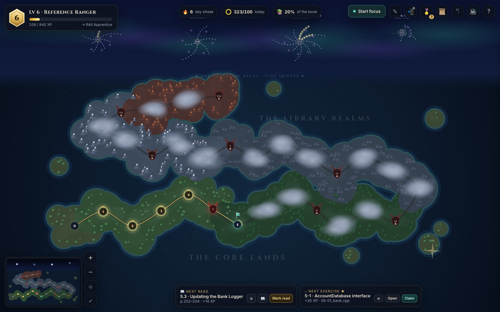
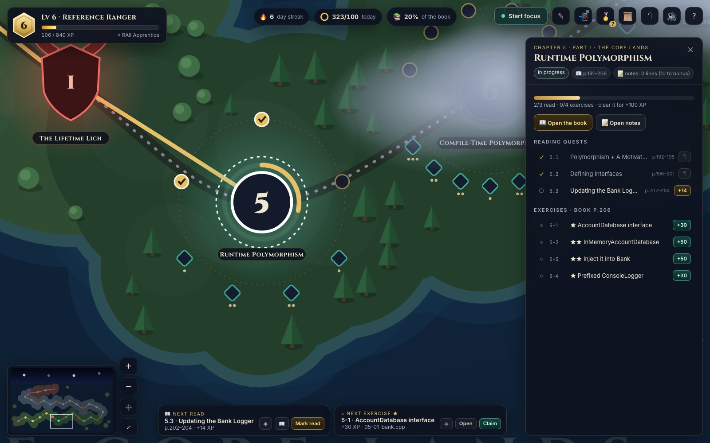
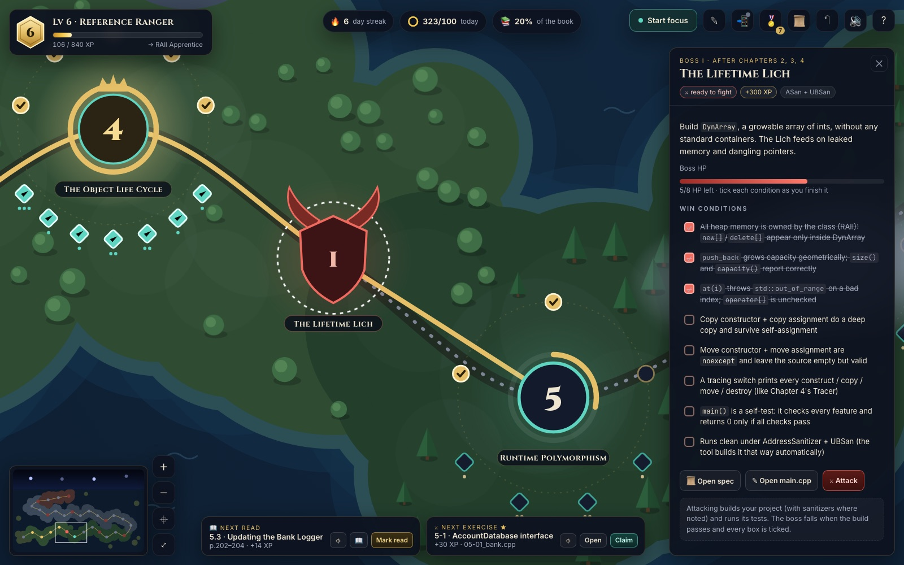
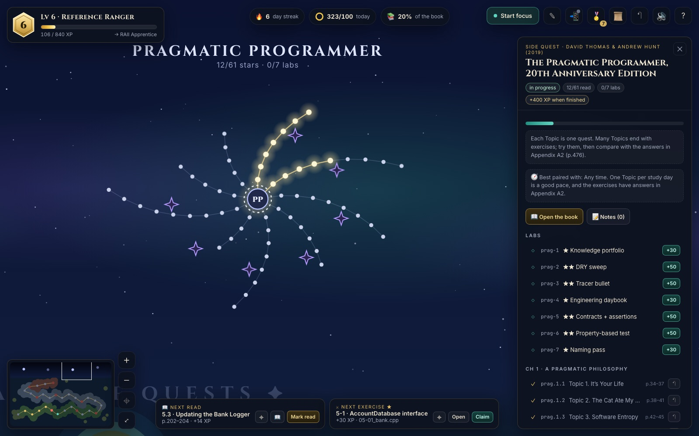
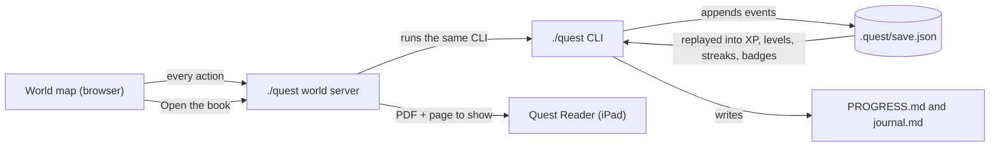

<div align="center">

# ⚔️ C++ Crash Course: The Quest

**Working through *C++ Crash Course* as a game you play in the terminal, in the browser and on an iPad.**




</div>

The book's 21 chapters become **115 reading quests** and **98 exercises**, plus **8 boss projects** and
**4 side-quest books**. Everything you do earns XP, builds a streak and unlocks badges. Exercises only count
once they compile, and bosses only fall when their sanitizer-checked builds and tests pass.

```
  ⚔  C++ CRASH COURSE · QUEST LOG
  Lv 6 · Reference Ranger    2,506 XP
  ███░░░░░░░░░░░░░░░░░░░░░  106/840 to Lv 7 RAII Apprentice
  🔥 Streak 6 days · best 6
  🎯 Today 323/100 XP  ████████████  goal hit! +25
  📚 Book 20%  ██░░░░░░░░░░  · 🏅 7/29 badges · ⏱️ 2h 50m focused
  last 14 days ········▄▃▅▆█▆

  ▶ Chapter 5 · Runtime Polymorphism   reading 2/3 · exercises 0/4
  Next up
    📖 5.3  Updating the Bank Logger  p.202–204  +14
    ⚔️  5-1 ★   AccountDatabase interface  +30
       ch05_runtime_polymorphism/exercises/05-01_bank.cpp  →  ./quest run 5-1 · ./quest done 5-1
    🐉 Boss 1 · The Lifetime Lich is waiting → ./quest boss 1
```

## ✨ What's inside

| | |
|---|---|
| 🧭 **`./quest` CLI** | One command shows your level, streak, daily goal and the exact next step. It also runs the focus timer, flashcard review, journal and an auto-generated progress page. |
| ⚔️ **Compile-checked exercises** | `./quest done 2-1` builds your code with `-Wall -Wextra`. No XP for an empty file or a failing build, and +10 for zero warnings. |
| 🐉 **Boss projects** | Eight multi-chapter projects (a RAII container, an RPN calculator, a thread pool, a Boost.Asio chat server, and more) built with AddressSanitizer, UBSan or ThreadSanitizer. |
| 🗺️ **World map** | `./quest world` opens a pan-and-zoom fantasy map in the browser. Every button runs the same CLI on the same save. |
| 📲 **iPad reader** | Pair an iPad by QR code. **Open the book** on the Mac turns the iPad to that exact page. |
| 🌌 **Side quests** | *The Art of Debugging*, *The GNU Make Book*, *The Pragmatic Programmer* and *PGP & GPG*, with hands-on labs tied to your C++ work. |
| 🐧 **Linux toolbox** | A dev container with GCC, GDB, Valgrind, strace, Make 4.3, CMake and Boost, the tools C++ teams use day to day. |

<table>
  <tr>
    <td width="50%"></td>
    <td width="50%"></td>
  </tr>
  <tr>
    <td align="center"><sub>Zoom into a chapter: gold circles are reading quests, teal diamonds are exercises</sub></td>
    <td align="center"><sub>Each boss's HP is its unticked win conditions</sub></td>
  </tr>
  <tr>
    <td colspan="2"></td>
  </tr>
  <tr>
    <td colspan="2" align="center"><sub>Side-quest books are constellations; stars light up as you read (screenshots use a demo save)</sub></td>
  </tr>
</table>

---

## 🚀 Quick start

**Requirements:** macOS or Linux, Python 3.8+, and `clang++` or `g++` with C++20 support (on a Mac:
`xcode-select --install`). Optional: Docker for the Linux toolbox, and an iPad for the reader.

1. **Bring your own copy of the book.** The PDFs aren't in this repo (they're copyrighted). Put your
   *C++ Crash Course* PDF in this folder; any filename containing "Crash Course" works. Side-quest PDFs go in
   their `side_quests/<book>/` folder (see [Side quests](#-side-quests-optional-books)).
2. Run `./quest` from this folder to see the dashboard.
3. Run `./quest world` to open the map, or carry on in the terminal:
   `./quest start` → read → `./quest read` → code → `./quest done 1-1` → `./quest stop "what clicked"`.

Optional: make `quest` work from anywhere by adding this to `~/.zshrc`:

```bash
alias quest="$HOME/Desktop/Coding/c++/Learning/CPP_Crash_Course_Book/quest"
```

---

## 🗺️ The world map

```bash
./quest world
```

The map runs on your own machine (`127.0.0.1` only) and uses the same save file as the terminal, so you can
switch between the two whenever you like.

- **Explore:** drag or two-finger swipe to pan (with a little slide), and use the mouse wheel, pinch or ⌘ +
  scroll to zoom. The minimap jumps anywhere. Chapters are regions along a road, bosses are horned lairs, and
  unexplored chapters sit under fog until you start them.
- **Zoom into a chapter** to see its quest ring. Pips under an exercise show its difficulty.
- **Click anything** to open its journal panel. From there you can mark reading done, open an exercise in
  VS Code, run it, compile-check and claim it, tick a boss's win conditions, or attack.
- **Look up** for the side quests: each book is a constellation.
- **Top bar:** level, XP, streak, today's goal, focus timer, journal, badges, undo and sound. Level-ups, cleared
  chapters, bosses and badges get their own animations.
- **Deep links:** `#ch:5`, `#boss:1`, `#side:prag`, `#world` or `#sky` jump straight there; add `@1.4` to
  set the zoom. Press `?` for every shortcut.

## 📲 Read on your iPad

```bash
./quest world --ipad
```

1. Put the Mac and iPad on the same network. If macOS asks whether Python may accept incoming connections,
   click **Allow**.
2. Click **📲** on the Mac's map and scan the QR code with the iPad's camera. The **Quest Reader** opens.
   Share → **Add to Home Screen** turns it into a full-screen app.
3. **Open the book** on any quest in the Mac's map now turns the iPad to that exact page, in all five books.
   Side books whose printed page numbers differ from the PDF's still land on the right page.

On the iPad, swipe or tap the edges to turn pages and tap the middle to show the bars. The top bar shows which
reading quest you're in, with a **Mark read** button (the XP lands on the Mac). It remembers your place in
each book.

> [!NOTE]
> Only devices that scanned the code can connect. The key lives in `.quest/pair.key` (git-ignored), so you
> pair once; delete that file to revoke access. Traffic isn't encrypted, so use your own network. Campus and
> office Wi-Fi often blocks devices from talking to each other; a phone hotspot works instead, and the 📲
> screen lists every address the Mac can be reached on. A USB-C cable alone doesn't connect Safari to the
> Mac. The reader loads Mozilla's PDF.js from a CDN, so it needs internet the first time.

---

## 🔁 The study loop

1. **Read** one quest at a time (2–10 pages each). `./quest ch <n>` shows page ranges.
2. **Type the listings** into the chapter's `listings/` folder and run them:
   `./quest run ch02_types/listings/listing_2-9.cpp`. Break them on purpose and read the compiler errors.
3. **Write notes in your own words** in the chapter's `notes.md`. After 10+ lines you get a 📜 notes bonus.
4. **Do the exercises** (`./quest ch <n>` shows the tasks), then claim them with `./quest done <id>`.
5. **Write 3–5 flashcards** anywhere in `notes.md`; `./quest review` brings back the ones you miss:
   ```
   Q: What does RAII stand for?
   A: Resource Acquisition Is Initialization
   ```
6. **Fight the boss** once its chapters are cleared.

Companion code from the author: <https://github.com/JLospinoso/ccc>. Check it *after* your own attempt.

---

## 🎮 Rules of the game

### XP

| Action | XP |
|---|---|
| 📖 Reading quest | 5 + 3 per page (max 35) |
| ⚔️ Code exercise ★ / ★★ / ★★★ | 30 / 50 / 80 |
| ✨ Builds with **zero warnings** (`-Wall -Wextra`) | +10 (fix the warnings and re-run `done` to claim it) |
| 📚 Reading / research / debugger exercises | 15 |
| 🏁 Chapter cleared (all reading + required exercises) | 100 |
| 🏰 Part I / Part II complete | 500 / 1000 |
| 🐉 Boss defeated | 300–750 |
| ⏱️ Focus session (`start` → `stop`) | 1 per minute, 10–90 per session |
| ♻️ Flashcard answered correctly | 2 (max 20/day) |
| 📜 Notes bonus (10+ lines in a chapter's notes) | 30 |
| 🔥 Streak bonus (once per study day) | 3 × streak length (max 30) |
| 🎯 Daily goal hit (100 XP by default; `./quest goal 150` changes it) | 25 |
| 🌌 Side-quest reading / lab (★ / ★★ / ★★★) | as reading / 30 / 50 / 80 |
| 📗 Side-quest book finished | 200–400 |
| 🏅 Badge unlocked (29 to find) | 25 |

**Levels:** 20 named ranks follow the book's arc, from **Hello, World** through **Pointer Wrangler**,
**Template Tinkerer** and **Concurrency Conjurer** to **Crash Course Conqueror**. They're spaced so the final
rank lands around the end of the book if you keep steady habits.

**🔥 Streaks and freezes:** any XP-earning action counts as studying that day, so one reading quest keeps the
streak. Every 7 streak days banks a ❄️ freeze (hold up to 2), which covers one missed day. Coming back after
7+ days earns the 🔄 **Comeback Kid** badge.

### 🐉 Bosses

| # | Boss | After chapters | Build |
|---|---|---|---|
| 1 | **The Lifetime Lich:** `DynArray` with RAII + copy/move | 2–4 | ASan + UBSan, self-test |
| 2 | **The Operator Overlord:** `Rational<T>` + concepts + literals | 5–7 | ASan + UBSan, self-test |
| 3 | **The Core Colossus:** `rpn` calculator (Part I finale) | 8–9 | ASan + UBSan, `--test` |
| 4 | **The Test Golem:** test-driven bank ledger | 10–12 | ASan + UBSan, test suite |
| 5 | **The Container Kraken:** `kvdb` key-value store | 13–15 | ASan + UBSan, stdin/stdout tests |
| 6 | **The Filesystem Phantom:** `dupes` duplicate finder | 16–17 | build |
| 7 | **The Parallel Wraith:** `wordstorm` thread pool | 18–19 | ThreadSanitizer |
| 8 | **The Network Dragon:** Boost.Asio chat server | 20–21 | Boost |

Each boss's HP is the number of unticked win conditions in its README (`projects/bossN_*/README.md`). Tick
them as you finish them, in the file or on the map. The boss falls when every box is ticked **and** the build
and tests pass.

### 🌌 Side quests (optional books)

They earn XP and keep your streak alive, but never block a chapter or a boss. The map suggests one when it fits
the chapter you're on.

| Key | Book | Quests | Labs | Best paired with | PDF filename must contain |
|---|---|---|---|---|---|
| `dbg` | *The Art of Debugging with GDB, DDD, and Eclipse* | 35 (+5 optional) | 5 | Ch 1, then whenever something crashes. GDB runs in the Linux toolbox; on the Mac use LLDB | `art.of.debugging` |
| `make` | *The GNU Make Book* | 32 (+5 optional) | 6 | Ch 8 and ch 21 (GNU Make 4.3 is in the toolbox) | `gnu make book` |
| `prag` | *The Pragmatic Programmer*, 20th Anniversary Ed. | 61 (one per Topic) | 7 | Any time, one Topic per study day | `pragmatic programmer` |
| `gpg` | *PGP & GPG: Email for the Practical Paranoid* | 16 (+9 optional) | 5 | Standalone. Commercial-PGP and 2006 mail-client chapters are optional | `practical paranoid` |

Labs are hands-on tasks tied to your C++ work: debugging your own exercises, writing a Makefile for this
folder, adding contracts to your boss code, signing your git commits with GPG, and so on.

---

## 🧰 Commands

```
./quest                       dashboard + next steps
./quest world [--ipad]        the clickable world map (--ipad: pair an iPad reader)
./quest start / stop ["note"] focus timer (stop -m 45 fixes a forgotten timer)
./quest read [2.3|2|2.all]    mark reading done (no argument = the next one)
./quest run <id|bossN|file.cpp> [--asan|--tsan] [-- args]
./quest done <id> ["note"]    compile-check + claim (--force skips the check, no ✨ bonus)
./quest ch [n] · map · boss [n] · badges · stats
./quest side [key]            side books / one book's quests + labs
./quest read dbg | dbg.2 | dbg.2.3   next quest in a side book / its chapter / one quest
./quest done dbg-1 ["note"]   claim a side lab · ./quest pdf dbg opens that book
./quest review [n] [ch3]      flashcards
./quest log "text"            add a line to journal.md
./quest undo [id]             take back the last action (everything is recomputed, so it's safe)
./quest pdf · goal <xp> · init · help
```

Builds use `$CXX` (default `clang++`) with `-std=c++20 -Wall -Wextra -g` and write to `.build/`
(git-ignored). A source file can add its own flags with a comment line, for example to link a Boost library:

```cpp
// quest-flags: -lboost_program_options
```

---

## 🐧 Linux toolbox

Most C++ teams build, debug and ship on Linux, so this folder includes a dev container with the tools you'll
meet at work. It runs natively on Apple silicon and shares this folder with your Mac, so code, notes and quest
progress are the same in both.

| Tool | What it's for | Where it comes up |
|---|---|---|
| `g++` 13 (GCC) | the default Linux compiler; a second opinion next to Apple clang | everywhere |
| `gdb` | the standard Linux debugger | Ch 1, *Art of Debugging* |
| `valgrind` | finds leaks and invalid memory access | Ch 4, Ch 11, *Art of Debugging* ch 7 |
| `strace` / `ltrace` | watch the system and library calls a program makes | *Art of Debugging* ch 7, Ch 17, Ch 20 |
| GNU Make 4.3, CMake, Ninja | build systems | *GNU Make* side quest, Ch 21 |
| Boost, Catch2, GoogleTest | libraries the book uses | Ch 10, 12, 20, 21, Boss 8 |

**With VS Code:** install the *Dev Containers* extension, open this folder and run **Dev Containers: Reopen in
Container**. The terminal is then Ubuntu: `./quest run 1-1` compiles with GCC, and **Run and Debug → "GDB:
debug active file"** debugs whatever file you have open.

**From a terminal:**

```bash
docker build -t cppcc-linux .devcontainer
```

```bash
docker run --rm -it --cap-add=SYS_PTRACE --security-opt seccomp=unconfined -v "$PWD":/work -w /work cppcc-linux
```

A program built in the container is a Linux program and won't run on the Mac (and the other way round).
`./quest run` and `./quest done` always rebuild first, so this only matters when you start a binary by hand.

---

## 🏗️ How it works



- **Event-sourced save.** `save.json` is an append-only list of events ("read 2.3", "done 2-1 clean").
  XP, levels, streaks and badges are recomputed from it on every run, which is why `./quest undo` is always
  safe and the rules can change without corrupting old saves.
- **One rules engine.** The map and the iPad never change the save themselves: the server runs the same
  `./quest` commands the terminal does, so compile checks, XP and journal entries behave identically.
- **Book data** lives in `.quest/book.json`: page ranges for every reading quest (taken from each PDF's
  outline), plus exercises, bosses and side quests. Exercise descriptions are short paraphrases; the
  book is the full reference.
- **No dependencies.** The CLI and server are a single Python file using only the standard library. The
  browser pages are plain HTML/SVG/JS; the reader loads PDF.js and the pairing screen loads a QR-code
  library from cdnjs.
- **Security.** The server listens on `127.0.0.1` unless you pass `--ipad`. Every action needs a per-run
  token, and requests from other websites are rejected. Paired devices need the key from the QR code.
  Opening files in your editor and showing the QR code are Mac-only.

## 🗂️ Folder map

```
CPP_Crash_Course_Book/
├── README.md               ← you are here
├── quest                   ← the game: CLI + world server (Python 3, standard library only)
├── PROGRESS.md             ← auto-generated scoreboard: map, badges, heatmap, recent activity
├── journal.md              ← study log (sessions, notes, milestones)
├── cheatsheet.md           ← one living page of things you keep looking up
├── chNN_<topic>/           ← one folder per chapter (ch00 = optional prologue for C programmers)
│   ├── notes.md            ← your notes (starts empty)
│   ├── listings/           ← type the book's listings here
│   └── exercises/          ← one empty .cpp per exercise; ids match the book (2-1, 2-2 …)
├── projects/bossN_<name>/  ← boss spec (README.md with win conditions) + main.cpp
├── side_quests/<book>/     ← notes.md, lab/ where needed, and your copy of the PDF
├── docs/                   ← screenshots for this README
├── .devcontainer/          ← Linux toolbox (Dockerfile + VS Code dev container config)
├── .vscode/ · .clangd      ← build task, GDB/LLDB debug configs, C++20 for the editor
└── .quest/                 ← book.json, save.json, world.html, reader.html, pair.key (git-ignored)
```

Every `.cpp` and `notes.md` starts empty; the tasks live in the game (`./quest ch 2`, `./quest side dbg`).
Exercises that build one program step by step share a file (2-1 → 2-4 all live in `02-01_calculator.cpp`).
Exercises with several files (8-1, 21-4) get a folder, and every `.cpp` in it is compiled together.
If a file gets deleted, `./quest init` recreates it without ever overwriting your work.

## 🛠️ Notes

- **Boost** (ch 12–13, 15–16, 20–21, Boss 8) is already in the Linux toolbox. On a Mac, run `brew install boost`.
- **Testing frameworks** (ch 10): the book's hand-rolled `assert_that` / `run_test` approach needs nothing
  extra. For Catch2 or GoogleTest, use the toolbox, or on the Mac `brew install catch2 googletest` and link with
  `// quest-flags: -lCatch2Main -lCatch2` or `// quest-flags: -lgtest -lgtest_main`.
- **Chapter 18** has no exercises in the book, so it gets three bonus quests (marked as such).
  **13-4** repeats 13-1 in the print edition, so it's a from-memory redo here.

## 💡 How not to quit

- **Shrink the day, keep the streak.** A tired evening's minimum is one reading quest.
- **End every session with `./quest`,** so tomorrow's first step is already on screen.
- **Stuck on an exercise for 30+ minutes?** Write the question in your notes and move on. Reading ahead
  counts, and you can come back.
- **Check `PROGRESS.md` once a week.** The heatmap shows how consistent you've been.

## 📚 Credits

- *C++ Crash Course* by Josh Lospinoso (No Starch Press, 2019).
  Side quests: *The Art of Debugging with GDB, DDD, and Eclipse* (Matloff & Salzman), *The GNU Make Book*
  (Graham-Cumming), *The Pragmatic Programmer* (Thomas & Hunt) and *PGP & GPG* (Lucas). The books aren't
  included; this repo has only the study system and my own work.
- [PDF.js](https://mozilla.github.io/pdf.js/) by Mozilla,
  [qrcode-generator](https://github.com/kazuhikoarase/qrcode-generator) by Kazuhiko Arase, and the
  Cinzel, Inter and JetBrains Mono fonts from Google Fonts.
