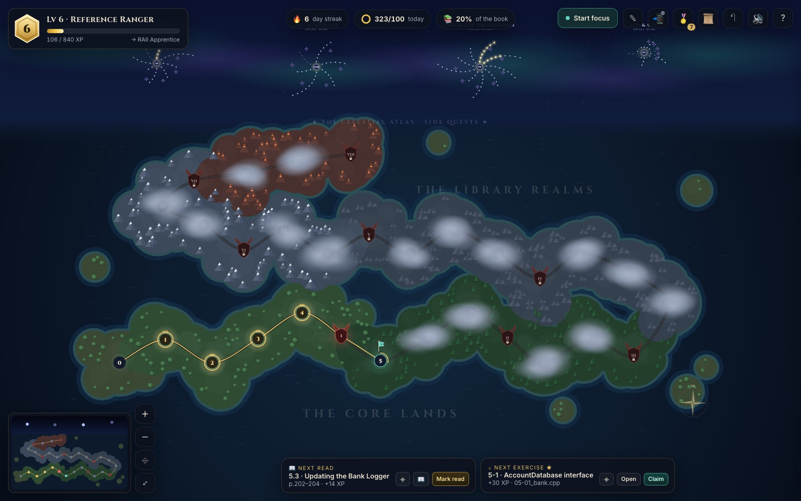

# ⚡ Algorithms & Systems

  
  
  

Welcome to the **Algorithms & Systems** repository. This project serves as a comprehensive monorepo of my C++ journey, spanning from advanced algorithmic competitive programming (Codeforces, AtCoder) to deep system-level C++ concurrency mechanisms and computer vision projects.

## 🏆 Competitive Programming (`SublimeC++`)

This directory acts as my primary competitive programming archive. It contains hundreds of C++ solutions to algorithmic challenges from platforms like **Codeforces**, **AtCoder**, and **LeetCode**. 
- Solutions are heavily optimized for time/space complexity and competitive programming environments.
- Contains extensive use of advanced data structures, graph theory, dynamic programming, and greedy algorithms.
- Formatted primarily through my Sublime Text C++ competitive programming setup.

## 🚀 Systems & Concurrency Module (`Learning/Random/`)

A deep dive into system operations, memory management, and multithreading in modern C++.

### Key Concepts Implemented:
- **Multithreading & Synchronization**: Implementation of multi-threaded architectures showing how to effectively spawn and join threads, utilizing hardware concurrency.
- **Mutexes & Locks**: Advanced locking mechanisms to prevent data races in shared resources. Covers standard `std::mutex`, `std::unique_lock`, `std::lock_guard`, `recursive_mutex`, and `timed_mutex`.
- **Condition Variables**: Event-driven thread synchronization allowing threads to efficiently wait for complex state changes.
- **Producer-Consumer Pattern**: A robust implementation of the classic Producer-Consumer problem using bounded buffers, threads, and condition variables.
- **Asynchronous Execution**: Deferred and asynchronous function execution leveraging `std::async`, `std::promise`, and `std::future`.
- **Smart Pointers**: Safe and automatic memory management using `std::shared_ptr`, `std::unique_ptr`, and `std::weak_ptr` to completely prevent memory leaks.

## 🔬 Computer Vision & Labs (`opencv_project/`, `lab/`)

- **OpenCV Projects**: Experiments and implementations combining C++ with OpenCV for computer vision tasks, image processing, and performance-critical visual operations.
- **Academic Labs**: Core university-level C++ labs spanning various computational and systems concepts.

## 🎮 C++ Crash Course Quest (`Learning/CPP_Crash_Course_Book/`)

My study system for working through *C++ Crash Course* (Josh Lospinoso): the book turned into a game.
- **`./quest` CLI** (Python, standard library only): XP, levels, streaks with freezes, badges, focus timer, flashcards and a study journal, with compile-checked exercises (`-Wall -Wextra`, bonus XP for zero warnings).
- **8 boss projects** spanning several chapters each (a RAII container, an RPN calculator, a thread pool, a Boost.Asio chat server), built with AddressSanitizer, UBSan or ThreadSanitizer.
- **World map** (`./quest world`): a pan-and-zoom browser map of the whole book with fog of war, boss lairs and side-quest constellations. Every click runs the same CLI.
- **iPad reader** (`./quest world --ipad`): pair by QR code, then *Open the book* on the Mac turns the iPad to the exact page.
- **Linux toolbox**: a dev container with GCC, GDB, Valgrind, strace, Make, CMake and Boost.

➡️ **[Full guide and screenshots](Learning/CPP_Crash_Course_Book/README.md)**

## 💻 IDE Configurations & Projects (`VScode C++`, `Xcode files`, `MyProject`)
Various localized C++ configurations and isolated sandbox environments tailored for different IDEs (VS Code, Xcode) to handle cross-platform C++ development and debugging efficiently.

---

## 🎯 About

Created by **[Arihant Kumar Jain](https://github.com/Arihant-Kumar-Jain)** as a centralized hub for continuous system-level programming exploration and advanced algorithmic competitive programming.
